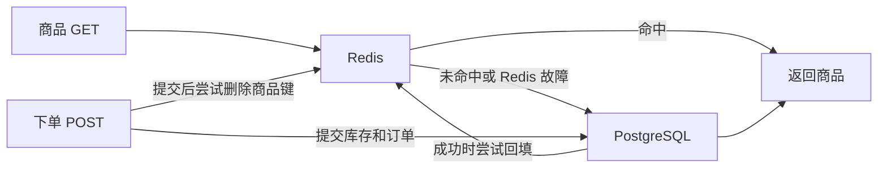

# 04 · Redis 缓存

商品查询走 Cache-Aside。Go 先读取 Redis 的 `product:1`，未命中时查 PostgreSQL，把结果缓存 20 秒。下单事务提交后删除对应键，下一次查询重新填充。下单扣库存直接执行数据库中的条件更新。



```bash
docker compose -f labs/stack/compose.yaml exec redis redis-cli DEL product:1
curl http://127.0.0.1:8082/products/1
curl http://127.0.0.1:8082/products/1
docker compose -f labs/stack/compose.yaml logs --tail=10 api
docker compose -f labs/stack/compose.yaml exec redis redis-cli TTL product:1
```

第一次是 `cache MISS`，第二次是 `cache HIT`。TTL 倒数到过期后，再读一次会重新发生 MISS。Redis 返回 `-2` 表示键已不存在。

## 让缓存失效和停机

先读取商品填充缓存，再用新键下一笔订单。立即查缓存键，应看到键已失效。下一次商品读取看到扣减后的库存。

```bash
curl -i http://127.0.0.1:8082/orders \
  -H 'Content-Type: application/json' \
  -H 'Idempotency-Key: cache-lesson-1' \
  -d '{"productId":1,"quantity":1}'
docker compose -f labs/stack/compose.yaml exec redis redis-cli TTL product:1
curl http://127.0.0.1:8082/products/1
docker compose -f labs/stack/compose.yaml stop redis
curl http://127.0.0.1:8082/products/1
docker compose -f labs/stack/compose.yaml logs --tail=10 api
docker compose -f labs/stack/compose.yaml start redis
```

Redis 停止期间会看到 `cache BYPASS`，数据库可用时商品查询仍能成功。删除失败或旧查询在删除后回填，都会让展示库存暂时落后。副本读取、一致性要求和并发程度会影响失效策略。 [Redis Cache-Aside](https://redis.io/docs/latest/develop/use-cases/cache-aside/)

### 练习

把 [实现](../labs/stack/store.go) 中的 TTL 改为 5 秒，重建 API，观察 MISS 是否变多。继续推演三种场景：大量不存在的商品查询造成穿透，单个热门键过期造成击穿，很多键一起过期造成雪崩。分别考虑短期缓存空结果、合并回源请求、给 TTL 加抖动。当前找不到商品时直接回源，适合用日志观察穿透。

[第 11 章](11-cache-reliability.md) 会复现限流计数，并推演写后删缓存仍然可能读旧值的具体时序。
