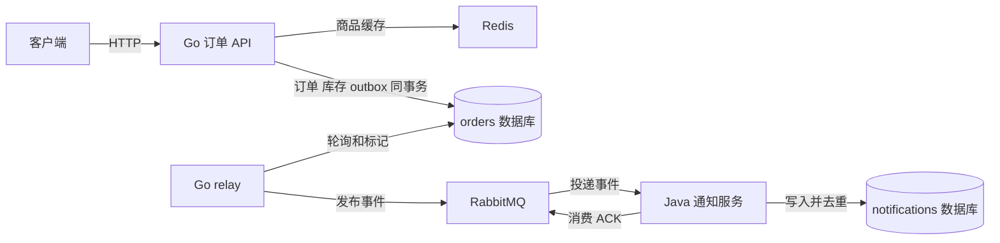

# 06 · 微服务与分布式系统

单个订单进程里可以用锁保护库存。两个 API 实例各有自己的锁和内存，跨进程后需要共享一致性边界。进阶实验用数据库事务协调订单和库存，以事件把通知的处理交给另一个服务。



订单负责库存规则与下单，通知负责将订单事件转成通知记录。relay 是订单服务的发布进程，和订单 API 一起使用 `orders` 数据库。两个业务服务在同一个 PostgreSQL 实例上使用不同的数据库，方便本地实验。Java 消费者通过 RabbitMQ 获得订单信息。

| 系统机制 | 在项目中怎么看 |
| --- | --- |
| 服务发现 | Compose DNS 让容器通过 `postgres`、`redis`、`rabbitmq` 这些服务名访问依赖 |
| 同步与异步 | HTTP 请求等待订单事务结果。通知通过事件投递，可以晚于 HTTP 响应完成 |
| 超时与重试 | Go HTTP 请求给数据操作 3 秒预算。客户端超时后带原来的幂等键重试，并限制次数、设置退避 |
| 扩展实例 | 多个 API 可连接同一个订单数据库，库存规则由数据库执行。共享缓存读结果允许短暂过期 |
| 可观测性 | 查 API 的缓存日志、relay 发布状态和 Java 消费日志，用 `orderId` 和 `eventId` 对上三处记录 |
| 局部故障 | Redis 断了可以用 PostgreSQL 读商品，RabbitMQ 断了可以先提交订单和待发送事件 |

更多实例通常还要考虑入口负载均衡、连接池上限、队列积压与背压。区分 API 延迟、最老 outbox 的等待时间和从订单提交到通知落库的延迟，三者分别对应不同故障位置。

## 实验：消息系统中断时下单

```bash
docker compose -f labs/stack/compose.yaml stop rabbitmq
curl -i http://127.0.0.1:8082/orders \
  -H 'Content-Type: application/json' \
  -H 'Idempotency-Key: distributed-lesson-1' \
  -d '{"productId":1,"quantity":1}'
docker compose -f labs/stack/compose.yaml exec postgres psql -U study -d orders \
  -c 'SELECT id, order_id FROM outbox WHERE published_at IS NULL ORDER BY id;'
docker compose -f labs/stack/compose.yaml start rabbitmq
```

RabbitMQ 停止期间，只要 PostgreSQL 有库存并且可写，API 会返回 `201`。此时 outbox 有待发送记录，Java 查不到对应通知。恢复后 relay 和消费者会重新连接，pending 记录被标记发送，通知随后落库。可以用 `docker compose -f labs/stack/compose.yaml logs --tail=20 relay notifications` 观察过程，再跑第 05 章的 SQL 查询验证。

## 一致性、复制与补偿

- **事务内的一致性**。事务和约束共同保护订单和库存，Redis 商品查询可以读到短暂过时的库存，通知通过重试和去重在处理恢复后追上。
- **网络分区**。CAP 要求在分区发生时明确选择哪些操作保持一致性、哪些操作还能提供服务。例如隔离的旧库存副本可以继续展示库存，直接允许它独立扣款或扣库存会带来冲突。实验用单节点 PostgreSQL 和 RabbitMQ，适合模拟服务停止。
- **复制与分片**。复制把同一份数据保留在多个节点，常用于故障恢复或扩展读容量。分片让不同节点存不同数据，按商品 ID 分片后，需要额外设计涉及多个商品或分片的订单。
- **Saga**。如果以后加入独立的支付和发货服务，可以让库存预留、支付和发货各执行本地事务。支付失败时触发释放库存作为补偿，补偿也要可重试并具备幂等性。当前订单和库存共享数据库事务，通知用 outbox。 [Saga orchestration](https://docs.aws.amazon.com/prescriptive-guidance/latest/cloud-design-patterns/saga-orchestration.html)

### 练习

1. 为“预留库存 → 支付 → 确认订单”画一张状态图，标出支付返回超时后的查询及重试，以及最终失败时的库存补偿。
2. 假设通知每日有十万条积压。分别从队列深度、消费速率、数据库耗时和重试率判断要先改哪里。
3. 分析为什么当前 relay 按 ID 查询只能方便地演示发布顺序。假设两个事务分配 ID 的顺序和提交顺序不同，再加入重新投递，说明业务若要求同一订单内有序需要增加什么信息。

在 [第 13 章](13-microservices-in-practice.md) 启动第二个 API 实例，验证两个进程怎样共用幂等规则，再用故障表解释哪些组件还需要单独考虑高可用。
