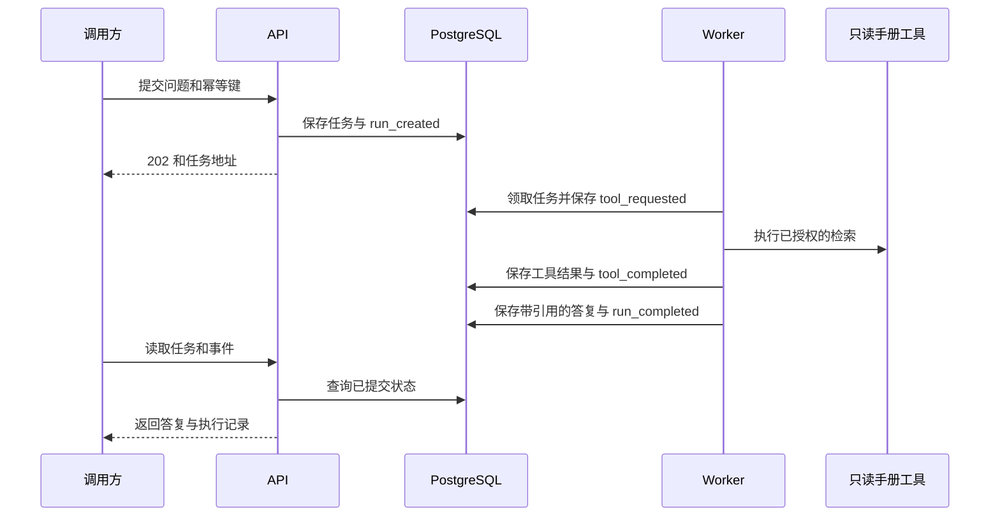

# Go Agent Runtime

提交一个订单系统故障，Agent 会查询本地运行手册，返回排查步骤和来源。API 接收任务，worker 分步执行，PostgreSQL 保存检查点和事件。每次工具调用的请求、结果和最终答复都可以通过 HTTP 查回。



## 运行和查看

从仓库根目录执行。默认监听本机 `18084`，单独使用一套 PostgreSQL 服务和数据卷。

```bash
docker compose -f labs/agent-runtime/compose.yaml up --build --wait
curl -fsS http://127.0.0.1:18084/releases
```

从 [React 学习工作台](../../docs/study-system.md#react-工作台) 的「Agent 实验」也能提交问题、按版本试跑、按任务 ID 回看结果，展开每一步的事件数据。

提交一次 RabbitMQ 排查任务。响应中的 `id` 用于查询任务，`Location` 响应头也会给出对应的路径。

```bash
curl -i http://127.0.0.1:18084/runs \
  -H 'Content-Type: application/json' \
  -H 'Idempotency-Key: demo-rabbitmq-1' \
  -d '{"input":"RabbitMQ 通知积压，怎样看 outbox？"}'
```

把 `1` 替换为刚才返回的 `id`。轮询到 `succeeded` 后，查看 `state.answer.citations`，应包含 `outbox-backlog`。事件列表中 `tool_completed` 还会给出工具读到的手册片段。

```bash
curl -fsS http://127.0.0.1:18084/runs/1
curl -fsS http://127.0.0.1:18084/runs/1/events
curl -fsS 'http://127.0.0.1:18084/runs/1/events?after=2'
```

省略 `release` 时，新任务采用当时的默认版本。同一 `Idempotency-Key` 搭配相同的问题，省略版本重试会返回原任务，即使默认版本已经切换。复用这个键提交不同的问题或指定不同版本会得到 `409`。想提交一条独立任务时，换一个键即可。

## 核心机制

| 岗位方向 | 原型实现 | 代码入口 |
| --- | --- | --- |
| Harness Kernel | `Model` 接口、逐步推进的执行循环、步骤预算、工具结果回填 | [engine.go](../stack/agentruntime/engine.go) |
| Managed Runtime | PostgreSQL 任务领取、检查点、租约回收、事件和状态同事务提交 | [store.go](../stack/agentruntime/store.go) · [worker.go](../stack/agentruntime/worker.go) |
| Context、Memory 与 Grounding | v1 检索最多取两条，v2 最多三条。证据随检查点持久化，答复校验引用 ID | [engine.go](../stack/agentruntime/engine.go) |
| Tool 权限与审计 | 工具注册、版本白名单、输入检查、拒绝事件 | [engine.go](../stack/agentruntime/engine.go) |
| Control Plane 与 Evaluation | 内置版本清单、候选评估、默认版本切换、回滚和评估审计。任务持久化自己的版本 | [eval.go](../stack/agentruntime/eval.go) · [releases.go](../stack/agentruntime/releases.go) |

内置版本使用确定性的模型适配器和只读手册，可以离线复现。权限检查发生在 Go 工具分发层，服务面向本机演示。 [岗位方向与后续扩展](../../docs/agent-infra-roadmap.md)

每次领取只推进一个步骤。多个 worker 用 `FOR UPDATE SKIP LOCKED` 竞争可领取任务。worker 崩溃后，租约过期的任务可以重新领取。每次领取增加租约代次，写入检查点时验证代次和到期时间。故障发生在工具返回以后、提交以前时，只读工具可能重跑，已提交的事件在事务和唯一键约束下只保存一次。带外部写操作的工具需要独立的幂等设计。 [PostgreSQL 16 的行锁与 SKIP LOCKED](https://www.postgresql.org/docs/16/sql-select.html#SQL-FOR-UPDATE-SHARE)

## 发布与回滚

`GET /releases` 返回可处理的版本，`active: true` 表示新任务的默认版本。通过门禁的内置版本允许通过显式 `release` 参数试跑。工具权限被收窄的 `ops-runbook-regression` 用来模拟真实回归，它会在 Redis、RabbitMQ 和无匹配场景失败。

在启动这套本地原型后，先评估候选。回归版本预期输出 `passed: false` 并以状态码 1 退出，v2 预期通过。评估使用固定的 `runbook-smoke-v1` 样本集。

```bash
docker compose -f labs/agent-runtime/compose.yaml run --rm --no-deps worker eval ops-runbook-regression
docker compose -f labs/agent-runtime/compose.yaml run --rm --no-deps worker eval ops-runbook-v2
```

`publish` 先复跑评估，再检查操作者给出的预期当前版本。合格且预期匹配时，切换默认版本、追加审计日志一起提交。回滚本质上是把已评估的 v1 再设为默认版本。切换命令经本机 Docker 运行。HTTP 层可以查看版本和提交任务。

```bash
docker compose -f labs/agent-runtime/compose.yaml run --rm --no-deps worker publish ops-runbook-v1 ops-runbook-v2
curl -fsS http://127.0.0.1:18084/releases
docker compose -f labs/agent-runtime/compose.yaml run --rm --no-deps worker publish ops-runbook-v2 ops-runbook-v1
```

从数据库查看切换过程和对应的评估快照。已创建任务始终使用自己保存的版本，回滚后排队中的 v2 任务仍会由 v2 完成。

```bash
docker compose -f labs/agent-runtime/compose.yaml exec -T postgres \
  psql -U agent -d agent_runtime -c \
  "SELECT previous_release, next_release, evaluation->>'dataset' AS dataset, changed_at FROM agent_release_changes ORDER BY id;"
```

## 验收

查看发布评估的四个样本。四项分别检查 Redis 排查引用、RabbitMQ 积压排查引用、无匹配证据和越权工具拦截。任一检查失败会返回非零退出码。

```bash
docker compose -f labs/agent-runtime/compose.yaml run --rm --no-deps worker eval
```

一键验收需要 Docker Compose 和 Python 3。脚本创建独立的 Compose 项目和数据库卷，使用动态端口，并在结束时清理本次资源。

```bash
python3 labs/agent-runtime/check.py
```

- 验证提交、幂等重放、冲突、证据引用和事件游标。
- 在工具完成但检查点尚未写入时，对 worker 发送 `SIGKILL`。确认接手的 worker 用同一个任务 ID 完成，并只留下顺序连续的一份事件。
- 暂停 worker，等接手的 worker 执行完成，再恢复旧 worker。确认旧租约写入被拒绝，最终任务和事件保持一致。
- 拒绝回归和过期发布，发布 v2 再回滚，验证新旧任务各按自身版本执行且保留两条带评估快照的审计记录。

结束本机演示时执行 `docker compose -f labs/agent-runtime/compose.yaml down`，命名卷中的记录仍可在下次启动时读取。
