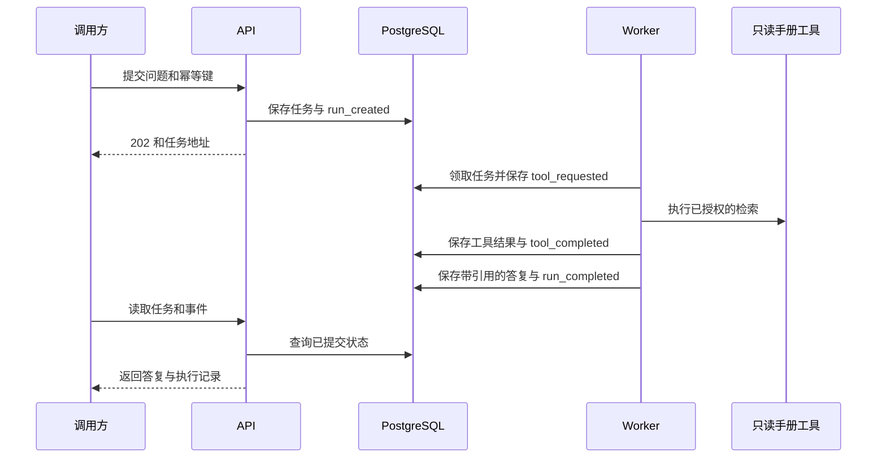

# Go Agent Runtime

提交一个订单系统故障，Agent 会查询本地运行手册，返回排查步骤和来源。API 接收任务，worker 分步执行，PostgreSQL 保存检查点和事件。每次工具调用的请求、结果和最终答复都可以通过 HTTP 查回。



## 运行和查看

从仓库根目录执行。默认监听本机 `18084`，单独使用一套 PostgreSQL 服务和数据卷。

```bash
docker compose -f labs/agent-runtime/compose.yaml up --build --wait
curl -fsS http://127.0.0.1:18084/releases
```

从 [React 学习工作台](../../docs/study-system.md#react-工作台) 的「Agent 实验」也能提交问题、按版本试跑、按任务 ID 回看结果，展开每一步的事件数据。

## 逐步查看构建回放

静态工作台的「Agent 实验」展示两个固定场景。用同一个跨组件故障比较 v1 和 v2，可以看到手册检索上限带来的引用差异。切到回归版本再逐步前进，可以看到权限拦截发生在工具执行前。右侧发布评估来自同一个 Go 命令。回放使用确定性模型和内存状态，检查点接手及数据库事务由下方 Docker 验收覆盖。

从仓库根目录生成回放 JSON，或启动静态预览。Go 版本要求见 `labs/stack/go.mod`。

```bash
(cd labs/stack && go run ./cmd/agent-runtime replay)
npm --prefix web ci
npm --prefix web run build:pages
python3 -m http.server 4176 --bind 127.0.0.1 --directory web/dist-pages
```

## 取消运行中的任务

在本机学习工作台提交问题后，任务状态是「排队中」或「执行中」时可以点「取消任务」。也可以在终端对同一个任务发出空 POST，把示例中的 `1` 换成仍在执行的任务 ID。

```bash
curl -i -X POST http://127.0.0.1:18084/runs/1/cancel
curl -fsS http://127.0.0.1:18084/runs/1/events
```

取消提交成功时返回 `200` 和 `cancelled`，事件列表多一条 `run_cancelled`。重复取消返回相同结果。已经成功或失败的任务返回 `409 run_already_finished`，不存在的任务返回 `404`。

关键在于取消和 worker 的提交竞争同一行。取消先提交时，任务进入终态，租约被清空，已经算完的 worker 结果也会被提交条件拦截。最终结果先提交时，取消返回冲突。此前已提交的证据仍可追溯。已经发出的外部调用需要它自己的取消协议或幂等设计。

## 重试失败或已取消的任务

打开本机的任务详情，在状态为「失败」或「已取消」时点「重试任务」。可以从新任务跳回原任务。列表和首条事件也会显示来源。命令行使用同一个接口，示例中的 `2` 要换成失败或已取消的任务 ID。

```bash
curl -i -X POST http://127.0.0.1:18084/runs/2/retry
```

首次请求返回 `202` 和新任务的 `Location`，重复请求返回 `200` 和同一地址。正在排队、执行中或已成功的任务返回 `409 run_not_retryable`，不存在的任务返回 `404`。原版本已经退役时，可读取已创建的重试。再创建新尝试会返回 `409 retry_release_unavailable`。如果新任务也失败，可以继续重试新任务。

新任务从空检查点开始，并使用原问题和原发布版本。数据库对 `retry_of` 建立唯一约束，并在同一事务中写入新任务及首条事件。这样并发请求只会产生一个直接重试，原任务和事件仍可追溯。故障恢复则沿用同一任务的检查点。 [重试实现](../stack/agentruntime/store.go)

提交一次 RabbitMQ 排查任务。响应中的 `id` 用于查询任务，`Location` 响应头也会给出对应的路径。

```bash
curl -i http://127.0.0.1:18084/runs \
  -H 'Content-Type: application/json' \
  -H 'Idempotency-Key: demo-rabbitmq-1' \
  -d '{"input":"RabbitMQ 通知积压，怎样看 outbox？"}'
```

把 `1` 替换为刚才返回的 `id`。轮询到 `succeeded` 后，查看 `state.answer.citations`，应包含 `outbox-backlog`。事件列表中 `tool_completed` 还会给出工具读到的手册片段。

```bash
curl -fsS http://127.0.0.1:18084/runs/1
curl -fsS http://127.0.0.1:18084/runs/1/events
curl -fsS 'http://127.0.0.1:18084/runs/1/events?after=2'
```

省略 `release` 时，新任务采用当时的默认版本。同一 `Idempotency-Key` 搭配相同的问题，省略版本重试会返回原任务，即使默认版本已经切换。复用这个键提交不同的问题或指定不同版本会得到 `409`。想提交一条独立任务时，换一个键即可。

## 翻看任务历史

本机页面在「Agent 实验」列出最近任务。按状态筛选后，可加载更早的任务，再点进一条查看事件。

```bash
curl -fsS 'http://127.0.0.1:18084/runs?limit=2'
curl -fsS 'http://127.0.0.1:18084/runs?limit=2&status=cancelled'
```

`limit` 默认 10，最大 50。`status` 可选，例如 `succeeded` 或 `cancelled`。继续翻页时保持原筛选，将上一页的 `nextCursor` 作为 `before`，直到游标为 `null`。任务 ID 和游标是十进制字符串，浏览器可以原样传回。列表只返回摘要，详情和工具证据仍用单条任务接口查询。

Go 先筛选状态和 ID，再按 ID 降序多查询一条。翻页过程中提交的新任务会出现在刷新后的首页。历史按请求时的状态筛选，运行中的任务完成后，可能从一个筛选结果移到另一个结果。

至少有三条任务时，用 Java 客户端消费 Go API 并验证前两页的 ID 严格倒序。对照 [Go 查询](../stack/agentruntime/history.go) 里决定排序与游标的位置，以及 [Java 客户端](../../java/src/main/java/study/AgentHistoryProbe.java) 里处理 HTTP 状态、解析 `long` 和验证游标的位置。

```bash
mvn -q -f java/pom.xml compile exec:java -Dexec.mainClass=study.AgentHistoryProbe
```

## 观察运行概览

从「Agent 实验」打开运行概览。暂停 worker 后提交任务并刷新，待领取数量会增加。恢复 worker，等任务结束后再刷新，成功数和耗时样本会增加。这些操作可以在隔离环境运行，完整验收见下方。

```bash
curl -fsS http://127.0.0.1:18084/runtime/overview
```

`queue.running` 包含租约过期的任务。`queue.expiredLeases` 单列其中已经能被其他 worker 领取的数量。`oldestQueuedAt` 是当前仍待领取的任务中最早的创建时间。

`recent` 按终态事件的时间统计最近 24 小时内的成功、失败和取消。工具权限被拒绝计入失败。P50 和 P95 统计成功任务从创建到完成的耗时，覆盖排队与执行，并显示样本数。没有成功样本时，两个分位数为 `null`。同一次查询使用同一个数据库时间与快照，页面可手动刷新。 [PostgreSQL 有序聚合与分位数](https://www.postgresql.org/docs/16/functions-aggregate.html#FUNCTIONS-ORDEREDSET-TABLE)

## 核心机制

| 岗位方向 | 原型实现 | 代码入口 |
| --- | --- | --- |
| Harness Kernel | `Model` 接口、逐步推进的执行循环、步骤预算、工具结果回填 | [engine.go](../stack/agentruntime/engine.go) |
| Managed Runtime | PostgreSQL 任务领取、检查点、租约回收、事件和状态同事务提交 | [store.go](../stack/agentruntime/store.go) · [worker.go](../stack/agentruntime/worker.go) |
| Context、Memory 与 Grounding | v1 检索最多取两条，v2 最多三条。证据随检查点持久化，答复校验引用 ID | [engine.go](../stack/agentruntime/engine.go) |
| Tool 权限与审计 | 工具注册、版本白名单、输入检查、拒绝事件 | [engine.go](../stack/agentruntime/engine.go) |
| Control Plane 与 Evaluation | 内置版本清单、候选评估、默认版本切换、回滚和评估审计。任务持久化自己的版本 | [eval.go](../stack/agentruntime/eval.go) · [releases.go](../stack/agentruntime/releases.go) |

内置版本使用确定性的模型适配器和只读手册，可以离线复现。权限检查发生在 Go 工具分发层，服务面向本机演示。 [岗位方向与后续扩展](../../docs/agent-infra-roadmap.md)

每次领取只推进一个步骤。多个 worker 用 `FOR UPDATE SKIP LOCKED` 竞争可领取任务。worker 崩溃后，租约过期的任务可以重新领取。每次领取增加租约代次，写入检查点时验证代次和到期时间。故障发生在工具返回以后、提交以前时，只读工具可能重跑，已提交的事件在事务和唯一键约束下只保存一次。带外部写操作的工具需要独立的幂等设计。 [PostgreSQL 16 的行锁与 SKIP LOCKED](https://www.postgresql.org/docs/16/sql-select.html#SQL-FOR-UPDATE-SHARE)

## 发布与回滚

`GET /releases` 返回可处理的版本，`active: true` 表示新任务的默认版本。通过门禁的内置版本允许通过显式 `release` 参数试跑。工具权限被收窄的 `ops-runbook-regression` 用来模拟真实回归，它会在 Redis、RabbitMQ 和无匹配场景失败。

在启动这套本地原型后，先评估候选。回归版本预期输出 `passed: false` 并以状态码 1 退出，v2 预期通过。评估使用固定的 `runbook-smoke-v1` 样本集。

```bash
docker compose -f labs/agent-runtime/compose.yaml run --rm --no-deps worker eval ops-runbook-regression
docker compose -f labs/agent-runtime/compose.yaml run --rm --no-deps worker eval ops-runbook-v2
```

`publish` 先复跑评估，再检查操作者给出的预期当前版本。合格且预期匹配时，切换默认版本、追加审计日志一起提交。回滚本质上是把已评估的 v1 再设为默认版本。切换命令经本机 Docker 运行。HTTP 层可以查看版本和提交任务。

```bash
docker compose -f labs/agent-runtime/compose.yaml run --rm --no-deps worker publish ops-runbook-v1 ops-runbook-v2
curl -fsS http://127.0.0.1:18084/releases
docker compose -f labs/agent-runtime/compose.yaml run --rm --no-deps worker publish ops-runbook-v2 ops-runbook-v1
```

从数据库查看切换过程和对应的评估快照。已创建任务始终使用自己保存的版本，回滚后排队中的 v2 任务仍会由 v2 完成。

```bash
docker compose -f labs/agent-runtime/compose.yaml exec -T postgres \
  psql -U agent -d agent_runtime -c \
  "SELECT previous_release, next_release, evaluation->>'dataset' AS dataset, changed_at FROM agent_release_changes ORDER BY id;"
```

## 验收

查看发布评估的四个样本。四项分别检查 Redis 排查引用、RabbitMQ 积压排查引用、无匹配证据和越权工具拦截。任一检查失败会返回非零退出码。

```bash
docker compose -f labs/agent-runtime/compose.yaml run --rm --no-deps worker eval
```

一键验收需要 Docker Compose 和 Python 3。脚本创建独立的 Compose 项目和数据库卷，使用动态端口，并在结束时清理本次资源。

```bash
python3 labs/agent-runtime/check.py
```

已经构建过当前代码的镜像时，可以加 `--reuse-image`，使用同样的隔离环境和验收步骤。

- 验证提交、幂等重放、冲突、证据引用和事件游标。
- 在工具完成但检查点尚未写入时，对 worker 发送 `SIGKILL`。确认接手的 worker 用同一个任务 ID 完成，并只留下顺序连续的一份事件。
- 暂停 worker，等接手的 worker 执行完成，再恢复旧 worker。确认旧租约写入被拒绝，最终任务和事件保持一致。
- 对排队任务并发发起两次取消，再取消一个工具已计算、结果待提交的任务。确认只有一条取消事件，原因保留，迟到的结果无法提交。
- 拒绝回归和过期发布，发布 v2 再回滚，验证新旧任务各按自身版本执行且保留两条带评估快照的审计记录。
- 读取任务历史第一页，再创建新任务。继续用原游标读第二页，验证顺序、筛选、无重复记录和非法参数处理。
- 在默认版本切换后并发重试一个已取消任务，再重试一个失败任务。确认各自只生成一个直接重试，继承原版本，原任务和事件仍可读取。
- 检查运行概览。对照空样本、过期租约和 24 小时窗口，用 100 ms 与 300 ms 两个样本验证 P50 和 P95。

结束本机演示时执行 `docker compose -f labs/agent-runtime/compose.yaml down`，命名卷中的记录仍可在下次启动时读取。
